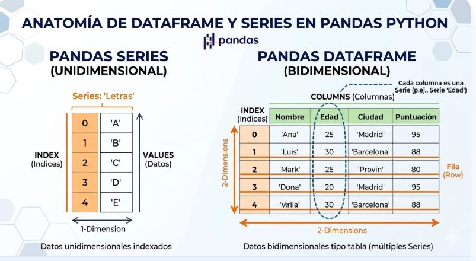
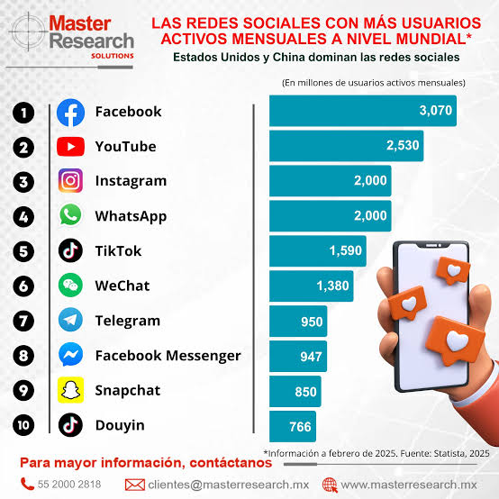
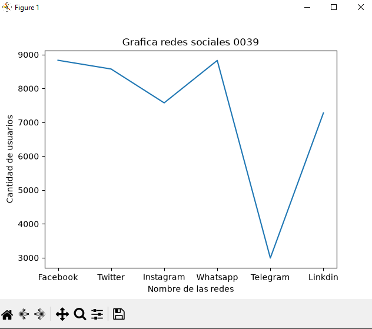
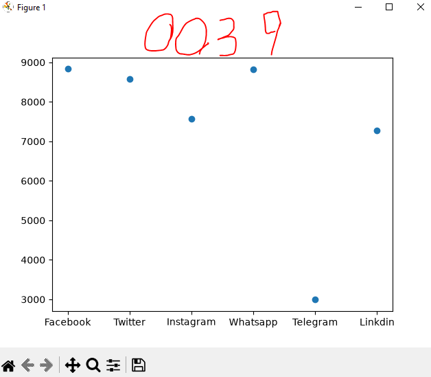
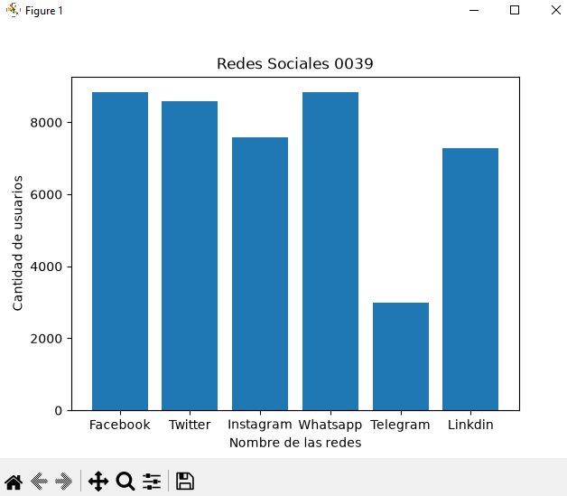
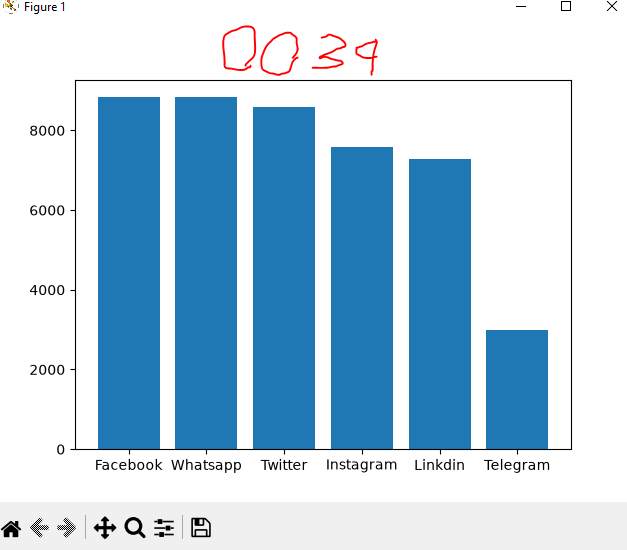
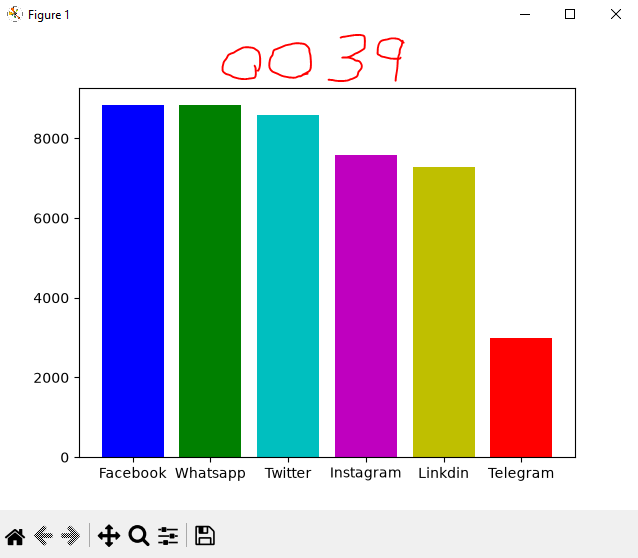
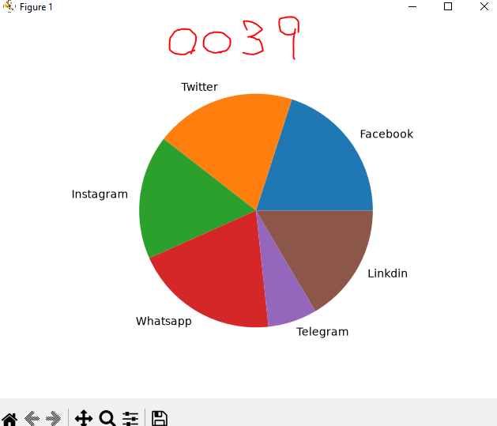

## Dataframe o marco de datos

## Redes sociales a nivel mundial

## Grafica lineal de redes sociales

## Gradica de puntos de redes sociales

## Grafica de barras de redes sociales

## Grafica de barras del mas grande al mas chico Descendente

## Coloreando la grafica

## Grafica de pastel o pie
